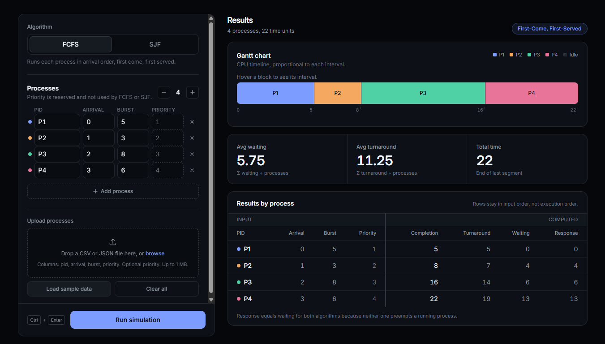

# CPU Scheduling Simulator

A web-based CPU scheduling simulator for CS16/L: Operating Systems final project. It simulates First-Come, First-Served (FCFS) and non-preemptive Shortest Job First (SJF) scheduling. Enter processes by hand or load them from a CSV or JSON file, choose an algorithm, and view the resulting Gantt chart, per-process timing table, and average CPU metrics.

## Features

- FCFS and non-preemptive SJF scheduling, selectable by the user
- Process input: number of processes, PID, arrival time, burst time, and priority
- Optional CSV or JSON file upload
- Gantt chart showing CPU execution order with time intervals
- Results table with completion, turnaround, waiting, and response time per process
- CPU metrics: average waiting time and average turnaround time
- Input validation with clear error messages (negative times, missing fields, duplicate PIDs, and more)

## Tech stack

| Layer | Tools |
| --- | --- |
| Backend | Python 3.11+, FastAPI, Pydantic v2, Uvicorn |
| Scheduling core | Python standard library only (dataclasses, typing) |
| Frontend | React 18, Vite, TypeScript, Tailwind CSS |
| Backend tests | pytest, httpx, FastAPI TestClient |
| Frontend tests | Vitest, jsdom |
| Linting | Ruff, TypeScript strict mode |

## Project structure

```
cpu-scheduling-simulator/
├── backend/
│   ├── app/
│   │   ├── main.py              FastAPI app, CORS, routes, error handler
│   │   ├── schemas.py           Request/response models and validation
│   │   └── scheduler/
│   │       ├── __init__.py      Algorithm registry and run_algorithm
│   │       ├── models.py        Dataclasses for processes and results
│   │       ├── metrics.py       CT, TAT, WT, RT, and averages
│   │       ├── fcfs.py
│   │       └── sjf.py
│   ├── tests/
│   │   └── test.py              Consolidated backend test suite
│   ├── requirements.txt
│   └── pyproject.toml           Ruff and pytest configuration
├── frontend/
│   └── src/
│       ├── api/client.ts        Fetch wrapper for POST /api/simulate
│       ├── types/index.ts       Shared request, response, and form types
│       ├── utils/parseUpload.ts CSV and JSON parsing
│       ├── utils/parseUpload.test.ts
│       ├── components/          Form, chart, table, metrics, and banner
│       ├── App.tsx
│       └── main.tsx
├── sample_data/
│   ├── sample.csv
│   └── sample.json
├── package.json                 root scripts: "npm run dev" starts backend and frontend together
└── README.md
```

## Getting Started

### Prerequisites

- Python 3.11 or newer
- Node.js 20 or newer
- npm

### One-time setup
From the project root:

```bash
# Root: installs the tool that runs both servers together
npm install

# Backend: create the virtual environment and install dependencies
cd backend
python -m venv .venv

  # Windows
  .venv\Scripts\python -m pip install -r requirements.txt 

  # Linux
  .venv/bin/python -m pip install -r requirements.txt

# Back to root folder
cd ..

# Frontend: install dependencies
npm --prefix frontend install
```

### Run the app
From the project root:

```bash
npm run dev
```

This starts both servers in one terminal:
- Frontend (open this in your browser): http://localhost:5173
- Backend API: http://localhost:8000 (interactive docs at http://localhost:8000/docs)

Press Ctrl+C once to stop both.

### Run the servers separately (optional)
```bash
# Terminal 1
cd backend && .venv\Scripts\python -m uvicorn app.main:app --reload

# Terminal 2
cd frontend && npm run dev
```

## Running the tests

Backend, from `backend/` with the virtual environment active:

```bash
pytest
```

The full backend suite lives in `backend/tests/test.py`. It covers the metrics, both algorithms, the verification dataset, tie-breaks, idle gaps, non-preemption, the API success paths, and every validation rule.

Frontend, from `frontend/`:

```bash
npm test
npm run typecheck
```

Linting, from `backend/`:

```bash
ruff check .
ruff format --check .
```

## Preview



## Usage

1. Choose FCFS or SJF from the segmented algorithm control. The line below it describes the selected policy.
2. Set the process count with the − and + stepper, or use "Add process" and the row remove button. Existing row data is kept. The limit is 1 to 100 processes.
3. Enter a PID, arrival time, burst time, and priority for each row. PIDs are suggested as P1, P2, and so on, but can be edited. Priority uses a dashed, dimmed field because it is reserved.
4. Optionally drop a CSV or JSON file on the upload zone, browse for one, or click "Load sample data".
5. Click "Run simulation", or press Ctrl + Enter (Cmd + Enter on macOS).
6. Review the Gantt chart, the three-cell metrics strip, and the per-process results table.

The input rows, Gantt blocks, legend, and results table share one colour per PID. Hover or focus a Gantt block to read its interval, such as "P3 ran from 8 to 16 (8 units)".

Priority is collected and validated, but neither algorithm uses it.

The "Clear all" button resets the form to one empty process row and removes any results, errors, and notices. The selected algorithm is kept.

The header shows a backend status chip: checking, connected, or offline. It is checked on load, when the window regains focus, and after each simulation attempt.

## Upload formats

Both sample files in `sample_data/` contain the verification dataset and can be uploaded from the UI.

### CSV

The header is required. `priority` is optional. Whitespace is trimmed and blank lines are ignored.

```csv
pid,arrival,burst,priority
P1,0,5,1
P2,1,3,2
P3,2,8,3
P4,3,6,4
```

### JSON

A JSON array of objects:

```json
[
  { "pid": "P1", "arrival": 0, "burst": 5, "priority": 1 },
  { "pid": "P2", "arrival": 1, "burst": 3, "priority": 2 }
]
```

Upload rules:

- Only `.csv` and `.json` files are accepted.
- The maximum file size is 1 MB.
- A successful upload fills the form rows and does not run the simulation automatically.
- Every bad row is reported. Bad rows are never skipped silently.
- Parse errors include a specific location, such as `Row 3: missing value for 'burst'.` or `Item 2: 'arrival' must be a number.`
- CSV error rows use physical file line numbers. JSON errors use the 1-based array item number.
- The parser checks structure and value types only. The backend enforces ranges, uniqueness, and reserved names.

## Verification dataset

| PID | Arrival | Burst | Priority |
| --- | --- | --- | --- |
| P1 | 0 | 5 | 1 |
| P2 | 1 | 3 | 2 |
| P3 | 2 | 8 | 3 |
| P4 | 3 | 6 | 4 |

FCFS results:

- Gantt: P1 0-5, P2 5-8, P3 8-16, P4 16-22
- Completion: P1 5, P2 8, P3 16, P4 22
- Waiting: P1 0, P2 4, P3 6, P4 13
- Average waiting: 5.75
- Average turnaround: 11.25

SJF results:

- Gantt: P1 0-5, P2 5-8, P4 8-14, P3 14-22
- Completion: P1 5, P2 8, P3 22, P4 14
- Waiting: P1 0, P2 4, P3 12, P4 5
- Average waiting: 5.25
- Average turnaround: 10.75

Idle gap example: P1 with arrival 2 and burst 3, P2 with arrival 10 and burst 2 produces `IDLE 0-2, P1 2-5, IDLE 5-10, P2 10-12` for both algorithms.